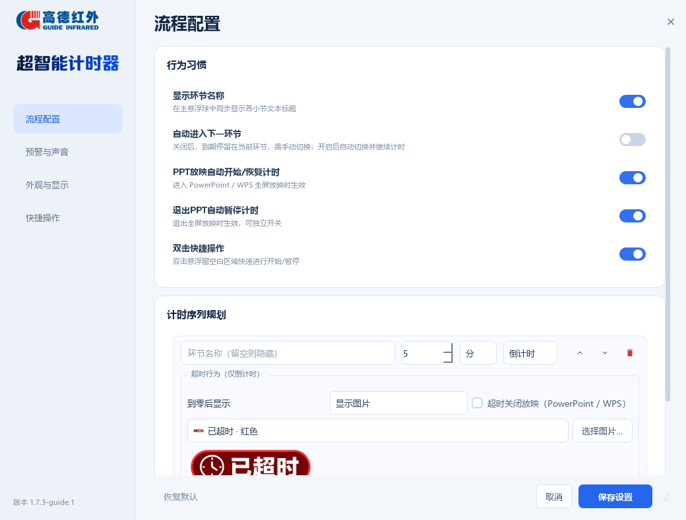
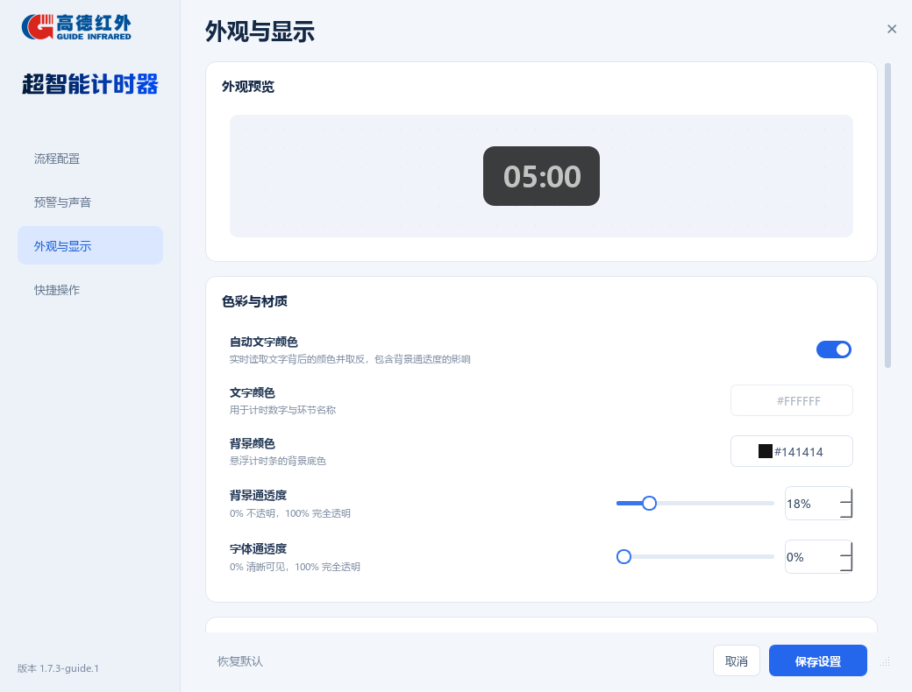

# 超智能计时器 1.7.3-guide.1

本项目是基于 [Qwejay/QTimer](https://github.com/Qwejay/QTimer) 的二次开发版本，保留原作者版权与 GPL-3.0 许可证。维护仓库：[zhouliangchen/QTimer](https://github.com/zhouliangchen/QTimer)。修改日期：2026-10-21。

## 1.7.3 更新

- 删除“流程配置”标题下的小字说明，与其他三页保持一致。
- 通过标题行内部间距统一将四页标题下移 10 像素，改善顶部留白与视觉平衡；顶部空白继续属于拖动区域，边缘缩放不变。

## 1.7.2 更新

- 移除标题行上方遗漏的 25 像素外部内边距，顶部视觉留白改为标题行内部的 8 像素间距。顶部侧栏、Logo 上方、标题行左右边距均可拖动，最上沿保留高度缩放。
- 拖动和缩放改为捕获鼠标事件后直接调整窗口，避免原生拖动接口返回成功但窗口未移动。缩放遵守窗口最小尺寸，关闭按钮与版本链接保持原有行为。
- 35 项回归测试通过。使用 Windows 实际鼠标验证：标题空白拖动后位置从 `(200,100)` 变为 `(280,130)`；左侧顶部空白拖动后变为 `(220,160)`；顶部缩放后位置为 `(220,180)`、高度从 790 变为 770。

## 1.7.1 更新

- 删除独立的顶部空行，将关闭按钮并入页面标题行。拖动标题行可移动窗口，标题行上沿或右沿可缩放，双击可最大化/还原；保留右下角缩放柄。关闭按钮与 Esc 均取消未保存的设置。
- 点击左下角版本号可在默认浏览器打开本 fork 仓库，也可使用 Tab 聚焦链接后按 Enter 打开。
- 悬浮计时文字的窗口坐标与绘制坐标在抽屉动画期间保持固定。仅改变按钮的滑动、透明度及可见区域，避免右侧贴边时反复移动/缩放整窗产生文字抖动；不可见区域不拦截鼠标。
- 跨越屏幕右侧三分之一区域时，已展开的按钮先在 140 ms 内收回，再从另一侧以 180 ms 展开。中途反向或改变悬停状态时，从当前进度继续过渡，计时文字保持锚定。日常展开/收回为 220 ms 的缓出动画。
- 拖动时以计时区为吸附锚点，按钮仍在换边期间也可顺畅跨越边界，不会被旧方向的按钮区域阻挡。
- 回归测试 34 项；Windows 原生测试覆盖 100%、125%、150%、200% 缩放，每档 42 个展开/收回帧的文字像素及位置一致，并检查隐藏按钮区域不拦截鼠标。原生验证脚本：

```powershell
.\.venv\Scripts\python.exe scripts/check_native_drawer.py
```


## 1.7.0 更新

- 隐藏整个系统标题栏，通过窗口上方空白区域拖动，右上角关闭按钮或 Esc 取消设置，右下角拖动柄可调整尺寸。保留左侧生成字标；移除左下角“基于 QTimer”标注和指定的四处说明文字。版权与许可证信息保留在源代码和项目文档中。
- “PPT放映自动开始/恢复计时”和“退出PPT自动暂停计时”独立开关，四种组合均可使用；放映中的手动暂停不会被自动检测覆盖。旧配置自动将原单开关值迁移至两个开关，保持原有行为。
- “计时序列规划 → 超时行为 → 到零后显示 → 显示图片”增加三张内置图片：已超时（红色）、时间到（蓝色）、请结束（琥珀色），可直接选择并预览，也可继续使用自定义图片。预置图片使用稳定标识保存，升级或独立程序临时解包目录变化不会使路径失效。[图片和完整生成提示词](../assets/overtime/README.md)。
- “外观与显示 → 色彩与材质 → 自动文字颜色”：开启后每 200 ms 读取环节名称和计时数字背后区域的颜色，考虑计时条背景的透明度后，分别取 RGB 反色；字体通透度仍生效。预警颜色优先生效，重置后恢复自动反色。关闭后恢复原来的自定义文字颜色；取消设置和恢复默认均可撤销自动颜色。

透明背景自动取色需要 Windows 10 2004 或更新版本。为避免把计时器自身的文字再次取样，启用 [Windows 窗口捕获排除机制](https://learn.microsoft.com/en-us/windows/win32/api/winuser/nf-winuser-setwindowdisplayaffinity)，因此部分系统截图/录屏中会隐藏计时条。关闭自动颜色，或将背景通透度设为 0%，会恢复捕获显示。屏幕正常显示与投影不受影响；不支持的系统或暂时无法采样时保留最近一次有效颜色。

本地回归验证：30 项自动测试通过；额外使用 Windows 原生窗口验证红、蓝、白、黑底色的动态采样、稳定反色，以及关闭自动模式后恢复窗口捕获。验证脚本：

```powershell
.\.venv\Scripts\python.exe scripts/check_native_colors.py
```




## 1.6.1 更新

- 设置侧栏的程序名称改为透明背景的科技风字标，采用深蓝至钴蓝的渐变，与浅蓝界面融合。保留高德红外官方标识、程序名称的无障碍描述，以及图片缺失时的文字回退。
- 字标作为本地资源随独立程序打包，无需联网加载；完整提示词见 [生成记录](../assets/wordmark-prompt.md)。

## 1.6.0 更新

- 软件名称统一为“超智能计时器”，包括设置窗口、启动入口、Windows 可执行文件及其属性。保留 `QTimer` 作为内部配置目录与单实例标识，直接沿用现有设置。
- 设置页重新设计：侧栏导航、清晰的分区标题、动画开关、可输入数值的滑块、颜色取样按钮，以及实时外观预览。设置窗口仍为非模态，支持键盘导航。
- 删除“全局穿透度”，同时移除旧的整窗透明度叠加。旧配置中的 `global_transparency` 字段会被忽略，背景和字体通透度分别生效。
- “恢复默认”统一恢复表单、滑块数值、预览和实际悬浮窗。背景通透度默认 18%，字体通透度默认 0%。更改只保存在设置草稿中，点击“保存设置”后应用；取消可撤销，正在运行的计时序列不会被草稿重置。
- 吸附到边缘后，拖动前 20 个逻辑像素保持吸附；超过阈值后连续跟随鼠标，消耗阈值位移以避免跳动。同一次拖动中不再重复吸回该方向的边缘，仍保留防出界。可以沿边缘平移，四边和角落均适用。



## 新增与改进

1. 程序窗口图标和设置页使用高德红外官方标识，来源记录在 `assets/README.md`。
2. 计时区中心进入当前显示器右侧三分之一区域后，按钮从计时器左侧展开。展开和收起保持计时区右边缘位置，便于贴右放置；其余区域仍向右展开。
3. 设置窗口为非模态窗口，打开时仍可拖动计时条。重复点击设置只显示同一个设置窗口。取消设置会撤销外观预览，保留拖动后的位置。
4. “流程配置 → 行为习惯 → 自动进入下一环节”：默认关闭，到期保留当前环节，手动点击上一/下一环节或对应快捷键切换。开启后到期自动进入下一环节并继续计时。
5. 环节名称留空或仅有空白时，自动隐藏名称及其占位。全局“显示环节名称”开关仍可控制所有环节。
6. 每个倒计时环节独立设置“超时行为”：显示 `00:00`、指定文字（默认为“已超时”）或指定图片；还可勾选“超时关闭放映”，自动退出已识别的 PowerPoint/WPS 全屏放映，文稿和编辑软件保持打开。正计时不执行超时行为。
7. 时间预警节点支持“保持闪烁”。勾选后持续闪烁，直到遇到未勾选的下一节点，立即停止闪烁并保留该节点颜色；切换或重置环节也会清除。普通节点仍保留原有短时闪烁。关闭声音不影响视觉预警；界面短暂卡顿跨过节点时也会按时间顺序处理。

超时文字/图片只有在关闭“自动进入下一环节”时保留；开启自动流转时，立即显示新环节。超时关闭放映动作在两种流转模式下均可执行。图片按比例缩放，不改动原图；图片路径必须在当前机器有效。文件失效时以超时文字兜底。

## 安装与启动

Windows，Python 3.11 或更新版本：

```powershell
python -m venv .venv
.\.venv\Scripts\python.exe -m pip install -r requirements.txt
.\.venv\Scripts\pythonw.exe main.py
```

环境就绪后可双击仓库中的 `启动超智能计时器.vbs`，不会弹出命令行窗口，旧的 `启动QTimer.vbs` 仍兼容。配置保存位置为 `%LOCALAPPDATA%\QTimer\config.json`，兼容旧版配置，新字段采用默认值。

构建独立 Windows 程序：

```powershell
.\.venv\Scripts\python.exe -m pip install -r requirements-build.txt
.\.venv\Scripts\python.exe scripts/build_windows.py
```

输出为 `dist/超智能计时器.exe`。构建脚本使用隔离的 DLL 搜索路径，避免 Poppler 等其他工具的 ICU/UCRT 库被误打入 Qt 程序。

默认快捷键：`Ctrl+Space` 开始/暂停，`Ctrl+Enter` 重置，`Ctrl+Left/Right` 上一/下一环节。PPT 自动开始/恢复与退出暂停分别使用独立开关，置顶显示需开启“窗口置顶”。自动计时采用 600 ms 轮询和连续两次确认，有约 1 秒检测延迟。

## 验证

```powershell
.\.venv\Scripts\python.exe -m unittest discover -s tests -v
```

自动化覆盖配置迁移、超时动作、正计时排除、流转开关、文字/图片切换、空名称、持续闪烁、静音预警、跨节点、右侧抽屉、设置非模态拖动、取消设置与表单保存。GitHub Actions 在 push/PR 时执行相同测试。

当前 23 项自动化测试还覆盖透明度恢复、滑块与百分比数值绑定、保存后重新打开、取消后恢复旧值、废弃全局透明度迁移，以及四边逐步拖动达到阈值后脱附。原生窗口现场将背景/字体通透度改为 87%/76%，点击恢复默认后确认回到 18%/0%，预览与悬浮窗同步恢复。

本机 Windows、单显示器 1920×1080：PowerPoint 16.0.19127.20860 和 WPS 12.1.0.28043 均通过进入全屏自动开始计时、浮窗置顶、倒计时结束显示“已超时”并自动退出放映的现场测试。测试使用独立临时配置和文稿，未修改日常配置。双屏演讲者模式及其他软件版本尚未实测。

## 维护

`origin` 指向维护 fork；`upstream` 指向原作者仓库。主分支为 `main`，当前开发分支为 `feature/guide-timer`。原有构建工作流已加入 Logo 和图标资源。发布带 `v` 前缀的标签会触发上游保留的打包发布流程。
